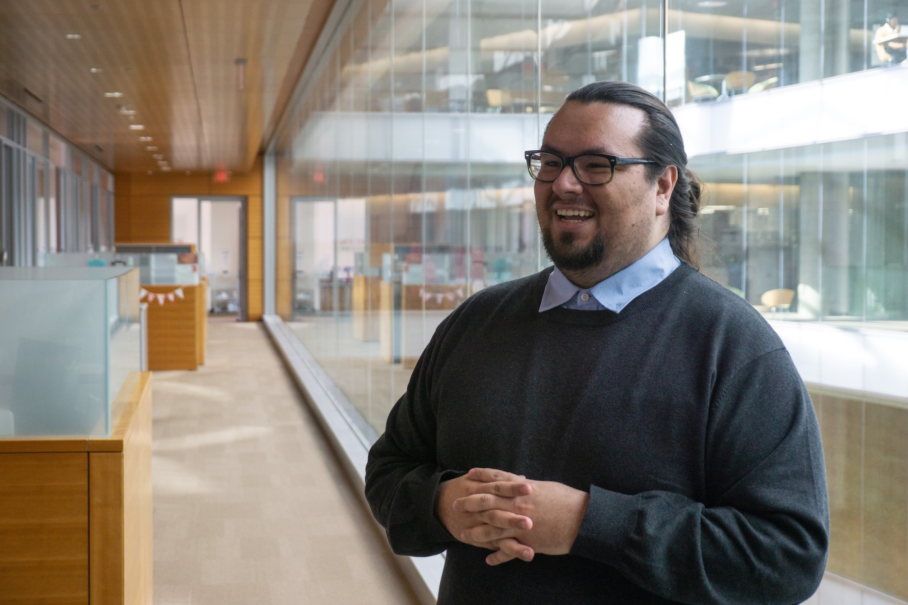

import Figure from '@/components/Figure';

If you are a current/prospective UW - Madison faculty member or PI and want to partner with CHTC,
see the resources below. It's always possible to connect with us as described
on [this page](/talk-to-us/).

<ButtonRow>
  <Button href='#for-faculty-hiring-committees' variant='contained'>Faculty Hiring</Button>
  <Button href='#for-prospective-or-incoming-faculty' variant='contained'>Prospective/Incoming Faculty</Button>
  <Button href='#for-current-faculty' variant='contained'>Current Faculty</Button>
</ButtonRow>

<MiniBar>
# For faculty hiring committees
</MiniBar>

CHTC staff are happy to meet with faculty candidates at any point in the recruitment
process - during their campus visit, during the offer negotiation process, or once
they are ready to start at UW - Madison. In these meetings, we can discuss computing
needs with prospective faculty, introduce CHTC capabilities, and discuss the possibility
of prioritized resources. **We strongly recommend introducing CHTC
to the recruitment process sooner rather than later** — early communication means
that we can lay the groundwork that will allow new faculty to hit the ground running.

### Resources

* [Set up a meeting between CHTC and potential faculty](mailto:chtc-faculty-recruiting@g-groups.wisc.edu)
* [One-pager: CHTC for Department Chairs](https://drive.google.com/file/d/1ynyIZY09UPKQsw9k2oS12kvKKzGeOUfF/view?usp=drive_link) (Only available via UW - Madison NetID)

<MiniBar>
# For prospective or incoming faculty
</MiniBar>

For prospective faculty who are negotiating a start up package and want to discuss computing
options at CHTC, please contact us using the email address below. For incoming faculty
who have committed to UW - Madison, we recommend reaching out for a meeting to discuss
your needs and outline a plan for implementation and onboarding your group. Even if you
met with us in the negotiation stage, it is helpful to have a follow up meeting after
hiring to confirm details.

### Resources

* [Meet with us about your startup proposal or computing needs](mailto:chtc-faculty-recruiting@g-groups.wisc.edu)
* [Request an account](/uw-research-computing/form/)

<MiniBar>
# For current faculty
</MiniBar>

If your group is new to CHTC, we recommend scheduling a meeting with us, and having your
group members join. After this meeting, we can create accounts on our systems
and provide next steps for getting started. You can initiate this meeting either by
using the email address below or requesting an account.

If your group is currently using CHTC, we want to partner with you in improving your
CHTC experience. The best way to do this is to contact us; we'll set up a meeting or call to
discuss any roadblocks or challenges you are experiencing, and arrange a follow-up
plan to address any issues.

### Resources

* [Contact us (for new or existing groups!)](mailto:chtc-facilitation@g-groups.wisc.edu)
* [Request an account](/uw-research-computing/form/)
* [Contact us about purchasing hardware](mailto:chtc-purchasing@g-groups.wisc.edu)
* [Cite CHTC](/uw-research-computing/cite-chtc/)

## Language for Grant Proposals

*Feel free to modify the below text, use only certain paragraphs, or contact us for more input or customizable letters of support.*

> The University of Wisconsin-Madison (UW-Madison) campus is an excellent match for meeting the computational needs of this project. Existing UW-Madison technology infrastructure supported by the CHTC can be readily leveraged, including CPU capacity, network connectivity, storage availability, and middleware connectivity. The UW-Madison has invested in the CHTC as the primary provider of shared, computing resources to campus researchers. All standard CHTC services are provided free-of-charge to UW-Madison researchers, their projects, and collaborators. But perhaps most important, the UW-Madison has significant staff experience and core competency in deploying, managing, and using computational technology.
> The CHTC is home to over 20 full-time staff with a proven track record of making compute middleware work for scientists. Far beyond just being familiar with the deployment and use of such software, UW staff has been intimately involved in its design and implementation. Dedicated Research Computing Facilitators are available to provide training to all CHTC users and are available to consult on computational practices for achieving the best scientific throughput. As always, CHTC will be happy to provide consulting to ensure optimal use of its facilities, and development of robust, reproducible methods for scalable computing.
> The UW-Madison maintains multiple compute clusters (including the largest of these operated by CHTC) across campus that are managed using either HTCondor or SLURM with support from CHTC. These clusters are connected by HTCondor technology to share resources with each other and with other institutions around the world via [OSG services](https://osg-htc.org/). Local computing capacity directly enabled by CHTC includes:
> - High-Throughput Computing (HTC) resources totaling about 30,000 CPU cores in support of research. Temporary file space for large individual files can support up to hundreds of terabytes of total working data. For single computing runs needing significant memory on a single server, the CHTC maintains several multi-core servers with terabytes of memory.
> - When on-campus resources are fully utilized, CHTC leverages [OSG services](https://osg-htc.org/) to provision additional opportunistic resources from multiple external sites.
> - A High-Performance Computing (HPC) cluster consisting of roughly 7,000 tightly coupled cores. Compute nodes have 64 or 128 cores each, and 512 GB RAM, and are networked with 200 Gbps Infiniband, with access to a shared file system and resources managed via Slurm.
> - An origin server where users can make research data available through the [Open Science Data Federation](https://osg-htc.org/services/osdf.html) and an on-campus cache server which allows external jobs to cache files locally.
> In the last year, CHTC made possible the use of more than 40,000 core years of computing work for campus researchers, supporting over 300 projects across a wide range of research domains. Temporary storage space for large files can support up to hundreds of terabytes of total working data. Should these resources not be sufficient for the project, the CHTC can also engage computing resources from across the campus grid and the [OS Pool](https://osg-htc.org/services/open_science_pool.html), an NSF-supported and expanding alliance of more than 100 universities, national laboratories, scientific collaborations, and software developers.
> The UW–Madison network currently comprises a 200Gbps backbone and WAN connectivity with 160Gbps to the Discovery building. The equipment is located on the “Research Backbone Network”, which allows for friction-free (e.g., no middlebox devices such as firewalls on the data path) to the nation’s research and education networks. Redundancy is built into the network and its supporting infrastructure. An equitable funding model assures that network resources are kept current. The UW has been fundamental to the establishment of the Broadband Optical Research Education And Science network (BOREAS). This Regional Optical Network (RON) connects to the CIC OmniPoP in Chicago, providing a high-speed gateway to various research networks, including Internet2, ESNet, CERN, and other global research networks. BOREAS, along with our participation in the Northern Tier Network Consortium, provides various options to connect at very high speeds to research partners with shared or dedicated bandwidth

*Last updated May 3, 2024.*