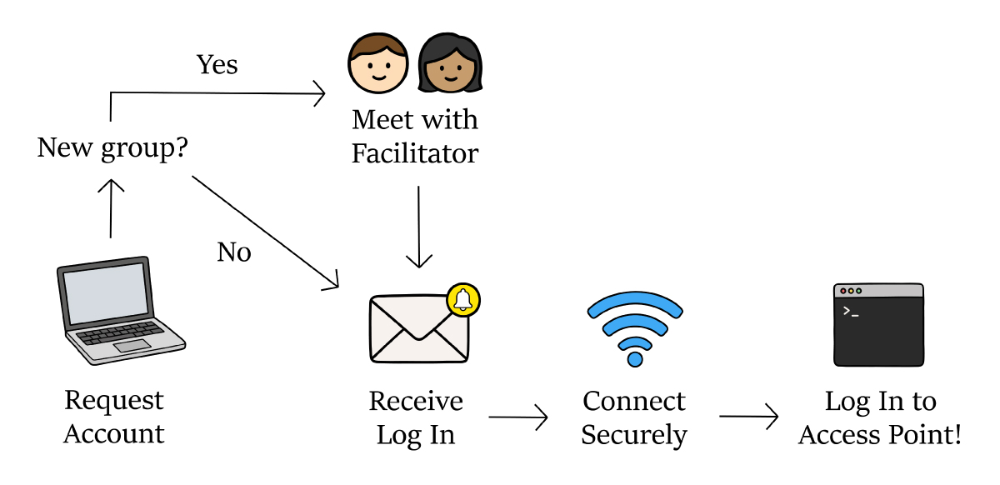

# Researchers

Follow the instructions below if you are a UW-Madison researcher (undergraduate, graduate, postdoc, staff, and faculty).

<Footnote>Process for requesting a CHTC account. If you are part of an new group, you will meet with a facilitator before your account is created.</Footnote>

<Tip header="How to request a CHTC account">

1. **Fill out the account request form.** Tell us about the computing work you want to do to the best of your knowledge.
2. You will receive an automated email from [chtc@cs.wisc.edu](mailto:chtc@cs.wisc.edu) within a few hours of completing the form.
3. **Wait 2-3 business days** for a follow-up from CHTC Facilitation Staff. Contact us at [chtc@cs.wisc.edu](mailto:chtc@cs.wisc.edu) if you don't hear from us after 3 business days.
   - **If you are part of a new research group**, we will first schedule a meeting with you to understand your computational needs before creating your account.
   - **If you are part of an existing research group**, we will create a new account. We don't require a meeting, but highly recommend meeting with us, especially if you are new to research computing!

<ButtonRow>

            <Button href="https://userapp.chtc.wisc.edu/forms/user-applications/create/">Request a CHTC Account</Button>

</ButtonRow>

</Tip>

<Tip header="Don't have a NetID yet?">

1. Your faculty sponsor should follow the instructions below in the [External Collaborators](#external-collaborators) section.
1. We will review the request and send you an invitation to create a NetID.
1. Once your NetID is ready, fill out the [Account Request Form](https://userapp.chtc.wisc.edu/forms/user-applications/create/)!

</Tip>

{/* more */}